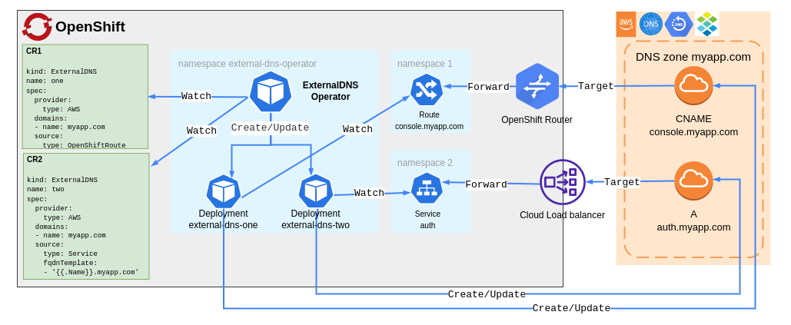

# OpenShift

This document provides information about how to use the `ExternalDNS Operator` in OpenShift Container Platform.

For metrics and webhook TLS policy selection and restart behavior, see
[Operator serving TLS security profiles](tls-security-profiles.md).

## How it works


## TLS certificates for validating webhook
Use the following convenience script to secure communication between the API and the Operator webhook: [add-serving-cert.sh](../hack/add-serving-cert.sh).
```bash
$ ./hack/add-serving-cert.sh --namespace external-dns-operator --service webhook-service --webhook validating-webhook-configuration --secret webhook-server-cert
```
